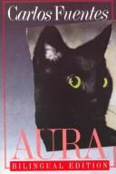

> [!info] Book Details
> **Author:** Carlos Fuentes  
> **Status:** Reading  
> **Rating:** 7 (Good)

Young historian takes a live-in job sorting out a dead general's papers inside a dark, rundown house in Mexico City, told entirely in second person ("you").
As the days go on, the old widow and her niece Aura start blending into each other in a weird, eerie way that makes you question what is actually happening.
