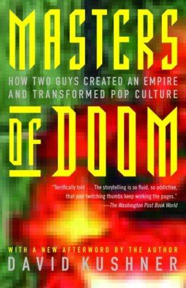

> [!info] Book Details
> **Author:** David Kushner  
> **Status:** Reading  
> **Rating:** 7 (Good)

Follows John Carmack and John Romero from two broke teenagers messing around with computers to building *Wolfenstein 3D*, *Doom*, and *Quake* at id Software.
Pretty fun seeing how two completely different personalities pulled off those games in the 90s before their egos and creative differences broke the studio apart.
