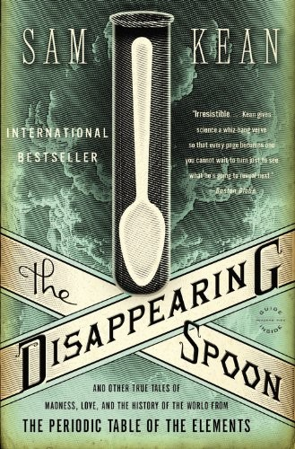

> [!info] Book Details
> **Author:** Sam Kean  
> **Status:** Reading  
> **Rating:** 5 (Average)

Goes through the periodic table using weird stories behind each element, like spoons made of gallium melting in hot tea and scientists sabotaging each other over discoveries.
Some chapters are genuinely interesting, though it jumps around a bit so it feels more like random trivia than one focused story.
