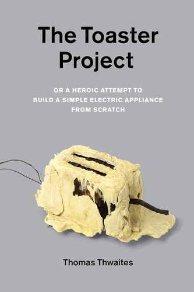

> [!info] Book Details
> **Author:** Thomas Thwaites  
> **Status:** Finished  
> **Rating:** 6 (Fine)

DIY toaster made from cheap plastic (£4) and built entirely from scratch, extracting mica from an abandoned mine, melting copper in a microwave oven and turning potatoes into plastic. 
In the end it just creates a gobbled out mess of plastic which short circuits. Even the simplest items in our daily lives require some insane logistics and teamwork hidden behind it.
