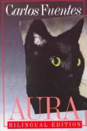
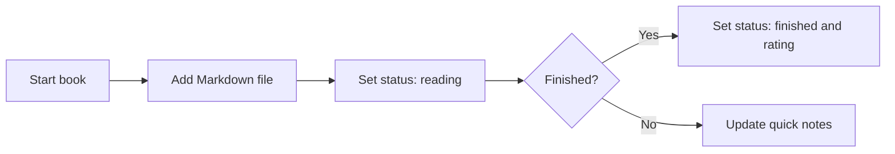

Use this guide to preview and copy every Markdown feature, callout, and Quartz component enabled on this site. All examples follow the [Canada.ca Content Style Guide](https://design.canada.ca/style-guide/): plain language, active voice, short sentences, sentence-case headings, and scannable lists.

## Content style principles

Follow these rules when you add or update reading notes:

* **Use plain language:** Choose simple, direct words over formal or literary phrasing.
* **Write in the active voice:** Say who does what instead of hiding the action.
* **Keep sentences short:** Aim for one main idea per sentence and one to three sentences per paragraph.
* **Use sentence case for headings:** Capitalize only the first word and proper nouns (for example, `## Book details`, not `## Book Details`).
* **Front-load key facts:** Put the title, author, status, and rating at the top of each book note.
* **Use scannable lists and tables:** Break up multi-part information instead of burying it inside long paragraphs.

## Frontmatter and page properties

Add YAML frontmatter between `---` markers at the top of a Markdown file to set its title, date, tags, and aliases. Quartz reads these fields for navigation, search, RSS, and page metadata.

```yaml
---
title: Aura
author: Carlos Fuentes
status: reading
rating: 7
date: 2026-11-18
aliases:
  - aura-fuentes
tags:
  - fiction
  - gothic
  - reading
---
```

* **`title`:** Sets the display title in Explorer, breadcrumbs, search, and the main page heading.
* **`date`:** Controls the date shown under the title and sorts entries in the RSS feed.
* **`aliases`:** Creates alternative names that wikilinks and search can resolve.
* **`tags`:** Generates clickable tag pills under the title and connects pages in the Graph View.
* **`draft: true`:** Excludes an unfinished note from the published site.

## Headings

Use `#` headings in strict order (`H2` under the page title, then `H3`, `H4`, and so on) so screen readers and the right-hand **Table of contents** stay structured. In this theme, `H1` and `H2` display a decorative crimson underline; `H3` through `H6` do not.

# Heading 1 (reserved for page titles)

## Heading 2 (main sections)

### Heading 3 (subsections)

#### Heading 4 (minor groups)

##### Heading 5 (small labels)

###### Heading 6 (smallest headings)

## Inline text formatting

Standard Markdown, GitHub Flavored Markdown (GFM), and Obsidian Flavored Markdown (OFM) inline styles all work inside paragraphs, lists, tables, and callouts.

| Style | Syntax | Rendered result |
| :--- | :--- | :--- |
| Bold | `**important point**` | **important point** |
| Italic | `*book title*` | *book title* |
| Bold and italic | `***key phrase***` | ***key phrase*** |
| Strikethrough (GFM) | `~~old rating~~` | ~~old rating~~ |
| Highlight (OFM) | `==favorite quote==` | ==favorite quote== |
| Inline code | `` `npm run build` `` | `npm run build` |
| Inline tag (OFM) | `#reference` | #reference |

Smart punctuation is also enabled: straight quotes like `"hello"` convert to curly quotes, and three dots `...` convert to an ellipsis.

To leave yourself private editorial notes in Markdown source that never appear on the live page, wrap text in Obsidian comment markers: `%%hidden note%%`. %%This sentence stays hidden in the HTML output.%%

## Links, embeds, and block references

Quartz resolves both standard Markdown links and Obsidian wikilinks, and displays hover preview popovers on internal links.

* **Wikilink to a note:** `[[2026/index|2026 log]]` renders as [[2026/index|2026 log]].
* **Wikilink to a heading:** `[[#Headings|Jump to headings]]` renders as [[#Headings|Jump to headings]].
* **Wikilink to a block:** Append `^block-id` to a paragraph, then link with `[[#^block-id|Jump to block]]` to link to [[#^sample-block|that paragraph]].
* **Standard Markdown link:** `[2026 log](2026/index.md)` links using relative file paths.
* **External link:** `[Canada.ca Content Style Guide](https://design.canada.ca/style-guide/)` adds an external link icon automatically.

This paragraph has a custom block identifier attached at the end so any note can link or transclude directly to it. ^sample-block

### Embedding another section

Use `![[note#Heading]]` or `![[note#^block-id]]` to transclude content inline from another note or block:

```markdown
![[2026/index#2026 Shelf]]
```

### Images with Obsidian sizing

Store book covers and screenshots in `content/attachments/` and size them with `|width` or `|widthxheight`:

```markdown

```


## Lists and task checkboxes

Use bullet lists for unordered items and numbered lists when sequence matters. Task checkboxes render with Alice Velvet accent styling, and Obsidian alternate checkbox states are enabled.

* First unordered item
  * Nested detail item
  * Second nested detail
* Second unordered item

1. First sequential step
2. Second sequential step
   1. Sub-step A
   2. Sub-step B

* [x] Completed task (`[x]`)
* [ ] Open task (`[ ]`)
* [/] In-progress task (`[/]`)
* [-] Cancelled task (`[-]`)

## Blockquotes and dividers

Use `>` for standard quotes and `---` on its own line for the centered pink-dot section divider.

> Simplicity is about subtracting the obvious and adding the meaningful.
>
> > Nested quote inside a blockquote.

---

## Tables

Use GFM pipe tables for structured comparisons. Include column alignment colons (`:---`, `:---:`, `---:`) on the separator row. Tables scroll horizontally inside a bordered container on small screens.

| Column (left) | Column (center) | Metric (right) |
| :--- | :---: | ---: |
| *Aura* | Reading | 7 |
| *Masters of Doom* | Reading | 7 |
| *The Toaster Project* | Finished | 6 |
| *The Disappearing Spoon* | Reading | 5 |

## Code blocks and syntax highlighting

Wrap multi-line snippets in triple backticks with a language name. Quartz highlights syntax for both light and dark themes and adds a copy button on hover.

```ts
type RatingLabel = "Good" | "Fine" | "Average"

export function formatRating(score: number, label: RatingLabel): string {
  return `${score} (${label})`
}
```

## Diagrams with Mermaid

Use a `mermaid` fenced code block to render flowcharts and reading workflows. Hover over a diagram to expand, zoom, and pan it.



## Footnotes

Place `[^label]` inline in a sentence and define `[^label]: explanation` anywhere in the note[^1]. Quartz collects footnotes at the bottom with return arrows.

## Obsidian callouts

Callouts highlight notes, warnings, summaries, and spoilers without breaking reading flow. Every built-in Obsidian callout type and alias is active.

### Informational and workflow callouts

> [!note] Note (`[!note]`)
> Standard slate callout for general context.

> [!abstract] Abstract (`[!abstract]`, aliases: `summary`, `tldr`)
> Short high-level summary of a book or chapter.

> [!info] Info (`[!info]`)
> Structured metadata, such as the Book Details box at the top of each book note.

> [!todo] Todo (`[!todo]`)
> Action items or follow-up reading tasks.

### Advice, confirmation, and questions

> [!tip] Tip (`[!tip]`, aliases: `hint`, `important`)
> Helpful advice, writing shortcuts, or reminders.

> [!success] Success (`[!success]`, aliases: `check`, `done`)
> Confirmed checklist completion or finished reading milestone.

> [!question] Question (`[!question]`, aliases: `help`, `faq`)
> Open questions to revisit after finishing a book.

### Warnings, errors, and spoilers

> [!warning] Warning (`[!warning]`, aliases: `attention`, `caution`)
> Important caveats, content warnings, or setup rules.

> [!failure] Failure (`[!failure]`, aliases: `missing`, `fail`)
> Dropped books, dead ends, or broken workflow notes.

> [!danger] Danger (`[!danger]`, alias: `error`)
> Critical issues or irreversible actions.

> [!bug] Bug (`[!bug]`)
> Rendering glitches or edge cases to inspect later.

### Examples and quotes

> [!example] Example (`[!example]`)
> Sample snippet or reading template.

> [!quote] Quote (`[!quote]`, alias: `cite`)
> Memorable excerpt copied from a chapter.

### Collapsible callouts and spoilers

Add `-` right after the closing bracket to keep a callout collapsed by default. This is the cleanest way to hide plot spoilers or long reference scales. Add `+` to make a callout collapsible but open by default.

```markdown
> [!warning]- Plot spoiler (click to expand)
> Hidden spoiler details stay collapsed until clicked.

> [!info]+ Expanded by default (click to collapse)
> Visible immediately, with an option to fold it away.
```

> [!warning]- Plot spoiler (click to expand)
> Hidden spoiler details stay collapsed until you click the title bar.

> [!info]+ Expanded by default (click to collapse)
> Visible when the page loads, and collapsible at any time.

### Nested callouts

Prefix inner lines with `>>` to nest one callout inside another.

> [!note] Outer note
> Main context stays on the outer card.
>
> > [!tip] Nested tip
> > Secondary detail sits inside the outer callout.

## Alice Velvet callouts and helpers

In addition to Obsidian's standard callouts, the Alice Velvet stylesheet adds custom editorial callout names and helper classes for literary notes.

> [!story] Story or journal (`[!story]`, `journal`)
> Styled with a soft pink highlight gradient for reading reflections and diary entries.

> [!clue] Clue or map (`[!clue]`, `map`)
> Styled with a crimson highlight gradient for mysteries, motifs, and plot threads.

> [!aside] Aside or note card (`[!aside]`, `note-card`)
> Muted background card for side commentary and small background facts.

> [!quote-card] Quote card or letter (`[!quote-card]`, `letter`)
> Italic Cormorant Garamond card for epigraphs, excerpts, and letters.

For custom block layouts in HTML, the stylesheet also provides `.alice-card`, `.alice-panel`, `.alice-gallery`, and `.alice-kicker`:

<div class="alice-card">
  <span class="alice-kicker">ALICE-CARD HELPER</span>
  <p>A bordered container with rounded corners and subtle elevation for featured summaries.</p>
</div>

## Enabled Quartz site components

These interface features are active across the site:

* **Search:** Press `Ctrl+K` (or `Cmd+K` on macOS) to search titles, body text, and tags with live previews.
* **Dark and light mode:** Toggle the theme button next to the search bar; your choice is saved in the browser.
* **Reader mode:** Click the book icon next to the theme toggle to fade out both sidebars while reading.
* **Explorer:** Browse folders and notes in the left sidebar.
* **Graph View:** Inspect nearby links in the right sidebar, or press `Ctrl+G` (`Cmd+G`) to open the full-screen Global Graph.
* **Table of contents:** Jump between headings on the current page from the right sidebar.
* **Backlinks:** See every page that links to the note you are reading.
* **RSS feed:** Subscribe to `/buku/index.xml` in any RSS reader for new and updated notes.

## Disabled features

To keep builds fast and lightweight, the following plugins are turned off in configuration and will stay as plain text:

* **LaTeX math:** `$x^2$` and `$$...$$` do not render equations.
* **Citations, Roam, and Ox-Hugo:** Academic BibTeX citations, Roam syntax, and Hugo shortcodes are disabled.
* **Comments and Recent notes:** Comment threads and the sidebar recent-notes widget are off.

[^1]: Footnote definitions can sit anywhere in the Markdown file; Quartz places them together at the bottom of the article.
